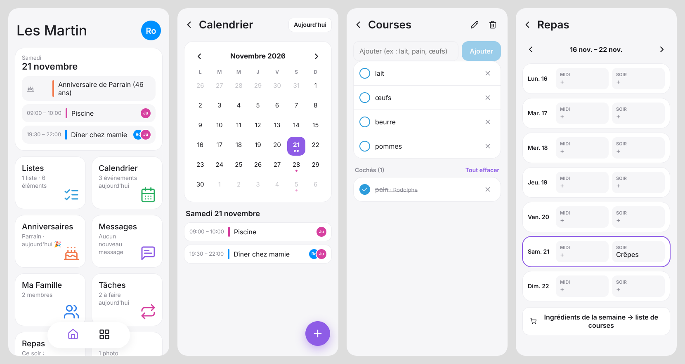

# Family App

Application familiale **local-first** (PWA) : les données vivent sur vos téléphones et sont partagées dans le
cercle familial **chiffrées de bout en bout**. Elle se publie sur **GitHub Pages** et s'appuie sur un petit relais
« aveugle » (Cloudflare Worker gratuit) qui ne voit jamais vos données en clair.



> 📐 **Choix d'architecture, comparatif des stratégies de partage, modèle de sécurité et conception des
> notifications : [docs/ARCHITECTURE.md](docs/ARCHITECTURE.md).**

## En bref

- **Données locales** : tout est enregistré sur l'appareil (IndexedDB). L'appli s'ouvre et fonctionne sans réseau,
  et les modifications faites hors ligne partent au retour du réseau.
- **Partage temps réel chiffré** : AES-256-GCM, clés générées et conservées uniquement sur les appareils. Le relais
  ne fait que stocker et rediffuser des paquets illisibles.
- **Ajout d'appareil sécurisé** : QR code à usage unique (15 min), approbation par un membre, code de vérification
  de 5 émojis, alerte « nouvel appareil » envoyée à toute la famille.
- **Téléphone perdu** : on retire l'appareil, une nouvelle clé est transmise aux seuls appareils restants.
- **Rappels, même appli fermée** : rendez-vous, résumé du matin, anniversaires (J-7 et jour J), tâches (et
  relances), repas du lendemain, planning de la semaine, messages, listes, et pour les enfants : travail du jour,
  cartable, petites questions de révision… Les rappels sont ciblés sur les
  personnes concernées, respectent les heures calmes et sont regroupés. **Leur contenu est chiffré** : le relais ne
  connaît que l'heure d'envoi.
- **Sauvegarde chiffrée** par phrase secrète, à garder hors du téléphone.

| Module | Ce qu'il fait |
| --- | --- |
| Listes | Listes partagées de quatre types : à cocher, **courses** (rangées par rayon), **simple** (à puces) et **projet** (colonnes à faire / en cours / fait, avec avancement). Ajout multiple (`lait, pain, œufs`), on voit qui a coché quoi |
| Calendrier | Vue mois + agenda, événements récurrents ou sur plusieurs jours, attribués, avec un rappel réglable par événement. Plusieurs calendriers à cocher : famille, anniversaires, école, jours fériés, vacances scolaires (zone A, B ou C), et calendriers importés (fichier .ics, ou abonnement par adresse : Google, Outlook, iCloud, club de sport…). **Cercles** : un évènement peut être réservé à un ou plusieurs cercles (« Moi seul », « Parents »…) ; il est alors chiffré pour eux seuls, les autres appareils de la famille ne le voient pas. Un nouvel appareil n'y a accès qu'après autorisation depuis un appareil qui y a déjà accès, et comparaison d'un code de 5 émojis. Chaque cercle a aussi sa conversation chiffrée dans *Messages* (« Moi seul » : notes personnelles) |
| Messages | Fil de discussion familial |
| Ma Famille | Membres, invitations d'appareils |
| Contacts | Numéros utiles, appel, e-mail et carte en un geste |
| Galerie | Photos réduites puis chiffrées avant l'envoi |
| Anniversaires | Triés par date à venir, âge, idées cadeaux |
| Repas / Recettes | Planning de la semaine lié aux recettes, **génère la liste de courses** |
| **École** | Par enfant : emploi du temps (semaines A/B), cahier de textes (devoirs, contrôles, leçons, exposés, choses à prévoir), **planification automatique en courtes séances avant l'échéance**, révisions espacées avant les contrôles, **leçons en questions/réponses apprises par petites notifications quotidiennes**, cartable de la veille, copie facultative des rappels aux parents |
| Tâches | Ponctuelles ou récurrentes, assignées, avec une heure optionnelle |
| Budget | Dépenses et entrées par mois, par catégorie |
| **Réveils** | Propres à chaque appareil (transférables, jamais partagés), répétition d'un toucher, glisser pour arrêter, défis (calcul, mots à recopier), réveil en douceur, mode chevet. Appli fermée : notification + 2 relances (pas de sonnerie continue, voir l'architecture) |
| Rappels | Notifications de l'appareil, préférences par membre, heures calmes, aperçu des prochains rappels |
| Sécurité | Appareils, retrait d'un appareil, code du cercle, sauvegarde, effacement |
| Personnaliser | Tuiles de l'accueil, ordre, couleur, nom de la famille |

## Mise en ligne (une fois, environ 15 minutes, possible depuis un téléphone)

Tout se fait dans le navigateur du téléphone, sur deux sites : **Cloudflare** (pour le relais) et **GitHub**
(pour l'appli). Aucun ordinateur n'est nécessaire.

### Étape 1 — Créer le compte Cloudflare et choisir son adresse

1. Ouvrez **dash.cloudflare.com** et créez un compte gratuit (adresse e-mail + mot de passe, puis validez l'e-mail).
2. Dans le menu, ouvrez **Workers & Pages** (parfois sous *Compute*). Si Cloudflare vous demande de choisir un
   **sous-domaine `workers.dev`**, choisissez-en un (par exemple votre pseudo). Il fera partie de l'adresse du
   relais : `https://family-app-relay.<sous-domaine>.workers.dev`.

### Étape 2 — Créer une clé d'accès Cloudflare pour GitHub

1. Toujours sur Cloudflare : icône de profil (en haut à droite) → **Profile** → **API Tokens** → **Create Token**.
2. Choisissez le modèle **Edit Cloudflare Workers** → **Use template**.
3. *Account Resources* : votre compte. *Zone Resources* : **All zones**. Puis **Continue to summary** →
   **Create Token**.
4. **Copiez le jeton affiché**. Il ne sera plus jamais montré ; en cas de perte, il suffit d'en recréer un.

### Étape 3 — Donner cette clé à GitHub

Sur **github.com**, dans votre dépôt : **Settings** → **Secrets and variables** → **Actions** → onglet **Secrets** →
**New repository secret** :

- **Name** : `CLOUDFLARE_API_TOKEN`
- **Secret** : collez le jeton → **Add secret**

Ce secret est chiffré par GitHub. Il n'est visible ni dans le dépôt, ni dans les journaux, ni par les forks.

### Étape 4 — Déployer le relais

Onglet **Actions** → **Relay** (dans la liste de gauche, ou le menu ☰ sur mobile) → **Run workflow** → branche
`main` → **Run workflow**.

Le workflow vérifie le code (tests sur un relais local), déploie le relais, crée **une seule fois** les clés de
notification et contrôle que le relais répond. Comptez 2 à 3 minutes. Ouvrez ensuite l'exécution terminée : son
**résumé** affiche l'adresse du relais.

Il se relancera tout seul à chaque modification du code du relais sur `main`.

### Étape 5 — Indiquer l'adresse du relais à l'appli

**Settings** → **Secrets and variables** → **Actions** → onglet **Variables** → **Repository variables** →
`RELAY_URL` (**New repository variable**, ou le crayon ✏️ si elle existe déjà) : collez l'adresse **exacte**
du résumé, par exemple `https://family-app-relay.mon-compte.workers.dev`.

- Pas dans *Secrets* : l'adresse n'est pas secrète, elle figure dans l'appli publiée.
- Pas dans *Environment variables* : la construction ne les voit pas.
- Une adresse invalide (par exemple avec `<compte>` laissé tel quel) fait échouer la construction avec un message
  explicite.

### Étape 6 — Publier l'appli sur GitHub Pages

1. **Settings** → **Pages** → *Build and deployment* → *Source* : **GitHub Actions**.
2. **Settings** → **Environments** → **github-pages** → *Deployment branches and tags* : vérifiez que **`main`** est
   autorisée. GitHub n'autorise que la branche par défaut du moment où Pages a été activé.
3. **Actions** → **GitHub Pages** → **Run workflow**. L'appli est en ligne sur `https://<compte>.github.io/family-app/`.

### Sur un ordinateur (facultatif)

Les mêmes étapes sont possibles en ligne de commande :

```bash
cd relay && npm ci && npx wrangler login
npx wrangler deploy                       # affiche l'adresse du relais
npm run vapid                             # puis : npx wrangler secret put VAPID_PUBLIC_KEY / VAPID_PRIVATE_JWK
```

Le workflow règle automatiquement `ALLOWED_ORIGINS` (`https://<compte>.github.io`) et `VAPID_SUBJECT` (l'adresse
du site) d'après le nom du dépôt. En ligne de commande, ce sont les valeurs de `relay/wrangler.toml` qui
s'appliquent. Avec un domaine personnalisé, créez la variable de dépôt `RELAY_ALLOWED_ORIGINS`
(ex. `https://famille.mondomaine.fr`).

> 🔐 **Important pour la sécurité :**
> - Activez l'**authentification à deux facteurs** sur GitHub et protégez la branche `main` : le code publié a accès
>   aux clés.
> - Tous les sites `https://<compte>.github.io/…` partagent le même stockage navigateur. **N'hébergez pas d'autres
>   projets GitHub Pages sur ce compte**, ou utilisez un **domaine personnalisé** (*Settings → Pages → Custom
>   domain*, puis mettez-le dans `ALLOWED_ORIGINS`).

Sans `RELAY_URL`, l'appli fonctionne en **mode local** : un seul appareil, sans partage ni notifications.

### Un service ouvert à tous

La page publiée n'est liée à aucune famille. **N'importe qui peut l'ouvrir, l'installer et créer sa propre famille.**
Chaque famille a ses propres clés, générées sur ses appareils : les familles sont invisibles et illisibles les unes
pour les autres, y compris pour vous qui publiez le site.

Le relais tourne sur **votre** compte Cloudflare. Pour qu'un inconnu ne puisse pas l'épuiser, il applique ces
garde-fous, réglables dans `relay/wrangler.toml` :

| Réglage | Défaut | Rôle |
| --- | --- | --- |
| `ALLOWED_ORIGINS` | `https://<compte>.github.io` | Seul ce site peut utiliser le relais depuis un navigateur. Le workflow le règle automatiquement d'après le nom du dépôt, y compris pour un fork. |
| `NEW_CIRCLES_PER_IP_PER_DAY` | 3 | Nouvelles familles par connexion et par jour. Le relais ne garde qu'une empreinte « adresse + jour », effacée sous 2 jours. |
| `NEW_CIRCLES_PER_DAY` | 100 | Nouvelles familles par jour, toutes connexions confondues |
| `CIRCLE_QUOTA_START_MB` / `CIRCLE_QUOTA_PER_DAY_MB` / `CIRCLE_QUOTA_MB` | 20 / 10 / 250 | **Quota progressif** : une famille commence avec 20 Mo, gagne 10 Mo par jour, jusqu'à 250 Mo. Une vraie famille ne s'en aperçoit pas ; personne ne peut remplir le relais d'un coup. |
| `INACTIVE_DAYS` | 400 | Une famille sans aucune connexion pendant ce délai est effacée du relais. Ses données restent sur les appareils et sont renvoyées si l'un d'eux revient. |

Retirer un appareil (renouvellement de clé) crée un nouveau cercle sur le relais. Celui-ci **garde l'ancienneté** de
l'ancien, sur preuve qu'il en détient le jeton, et ne compte pas comme une nouvelle famille.

L'adresse du relais n'est pas un secret : elle figure dans l'appli publiée. La protection repose sur les garde-fous
ci-dessus, qui s'appliquent à toute requête, d'où qu'elle vienne. `ALLOWED_ORIGINS` empêche en plus un autre site
de se brancher sur votre relais. Un programme écrit exprès pourrait contourner ce dernier réglage, mais il resterait
soumis aux garde-fous.

- **Coût** : avec l'offre gratuite de Cloudflare, il n'y a **pas de facture surprise**. Si les limites quotidiennes
  gratuites sont dépassées (environ 100 000 requêtes par jour), le relais refuse les requêtes jusqu'au lendemain.
  Cela représente déjà beaucoup de familles. Au-delà, l'offre payante démarre à environ 5 $/mois.
- **Transparence** : la page *À propos et confidentialité* explique à chaque visiteur où sont ses données et quelles
  sont les limites. Elle est accessible dès l'accueil, avant même de créer une famille.
- **Responsabilité** : vous hébergez des données chiffrées pour d'autres personnes, sans pouvoir les lire. Selon votre
  pays et l'ampleur d'usage, une mention légale ou un contact peut être attendu ; renseignez-vous si le service
  dépasse le cercle de vos proches.

### Installer l’appli sur les téléphones

- **Android** : ouvrir l'adresse dans Chrome, puis menu ⋮ → *Installer l'application*.
- **iPhone** : Safari → Partager → *Sur l'écran d'accueil*, puis **ouvrir depuis l'icône**. Le stockage de l'appli
  installée est séparé de Safari : rejoignez le cercle depuis l'appli installée.
- Le premier membre crée le cercle. Chaque autre appareil : *J'ai une invitation* → scanner le QR code affiché par un
  membre (*Ma Famille → Inviter*) → comparer les émojis → le membre approuve.
- Activez les rappels : *Ma Famille → Rappels → Activer les notifications*.

## Développement

```bash
npm install && npm --prefix relay install
node relay/scripts/vapid.mjs --dev-vars > relay/.dev.vars   # clés VAPID et limites relâchées pour le développement
npm run relay:dev                                            # relais local sur http://127.0.0.1:8787
VITE_RELAY_URL=http://127.0.0.1:8787 npm run dev             # appli sur http://localhost:5173
```

Pour tester le service worker, les notifications et le hors ligne, construisez l'appli :
`VITE_RELAY_URL=http://127.0.0.1:8787 npm run build && npm run preview`.

| Commande | Rôle |
| --- | --- |
| `npm test` | Tests unitaires : fusion des données (CRDT), cryptographie, calcul des rappels, planification école |
| `npm --prefix relay run test:ci` | Tests d'intégration du relais : authentification, synchro, Web Push déchiffré par une implémentation de référence, invitations, garde-fous du service public. Lance et arrête lui-même un relais local. |
| `npm run typecheck` | Vérification TypeScript |
| `npm run build` | Construit l'appli et le service worker dans `dist/` |

## Structure

```
web/src/
  lib/
    crypto.ts      clés, chiffrement AES-GCM, ECDH, codes de vérification, sauvegardes
    replica.ts     données locales + fusion sans conflit (CRDT, horloge hybride)
    sync.ts        synchronisation chiffrée avec le relais (WebSocket)
    engine.ts      cercle, appareils, renouvellement de clé, photos, sauvegardes
    invite.ts      invitation avec approbation
    reminders.ts   calcul des rappels (fonction pure, testée)
    school.ts      espace école : planification des séances, répétition espacée, rappels enfant/parents
    notify.ts      abonnement push, envoi des rappels et de l'activité
    idb.ts         stockage IndexedDB
  sw.ts            service worker : hors ligne + déchiffrement des notifications
  modules.tsx      ⭐ registre des modules
  pages/           un écran par module
  styles.css       thème
relay/src/         relais aveugle (Cloudflare Worker + Durable Objects)
docs/              architecture et sécurité
```

## La mettre à votre goût

- **Sans code** : *Applications → À votre goût* (modules de l'accueil, ordre, couleur).
- **Apparence** : variables CSS en haut de `web/src/styles.css`.
- **Ajouter un module** : les données sont des documents génériques, synchronisés et chiffrés automatiquement.
  **Ni le relais ni la synchronisation n'ont besoin d'être modifiés.**

  1. Créez `web/src/pages/Notes.tsx` :

     ```tsx
     import { useState } from 'react';
     import { useCollection } from '../store';
     import { Page } from '../ui';

     type Note = { text: string };

     export function NotesSummary() {
       const { docs } = useCollection<Note>('notes');
       return <>{docs.length} note(s)</>;
     }

     export function NotesPage() {
       const notes = useCollection<Note>('notes'); // collection partagée, chiffrée, synchronisée en direct
       const [text, setText] = useState('');
       return (
         <Page title="Notes">
           <form className="add-row" onSubmit={(e) => { e.preventDefault(); notes.create({ text }); setText(''); }}>
             <input value={text} onChange={(e) => setText(e.target.value)} />
             <button className="btn primary">Ajouter</button>
           </form>
           <ul className="items">
             {notes.docs.map((n) => (
               <li key={n.id} className="item" onClick={() => notes.remove(n.id)}>{n.text}</li>
             ))}
           </ul>
         </Page>
       );
     }
     ```

  2. Déclarez-le dans `MODULES` (`web/src/modules.tsx`) avec une icône de [lucide.dev](https://lucide.dev/icons) :

     ```tsx
     { id: 'notes', title: 'Notes', icon: StickyNote, color: '#F2B705', section: 'Organisation', Page: NotesPage, Summary: NotesSummary },
     ```

  `useCollection` fournit `docs`, `create`, `update` (fusion champ par champ) et `remove` ; chaque document reçoit
  automatiquement `id`, `createdBy` (le membre), `createdAt` et `updatedAt`.
- **Ajouter un type de rappel** : complétez `computeReminders` dans `web/src/lib/reminders.ts` (et son test).
